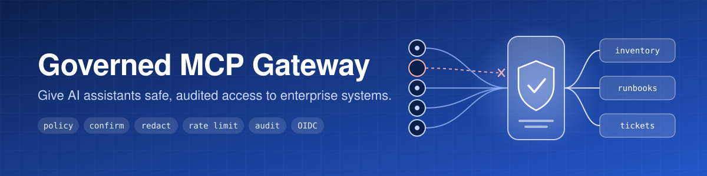
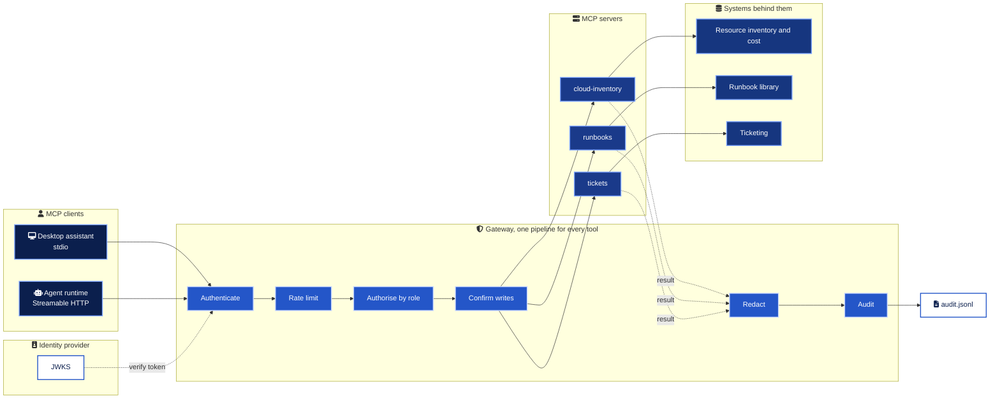
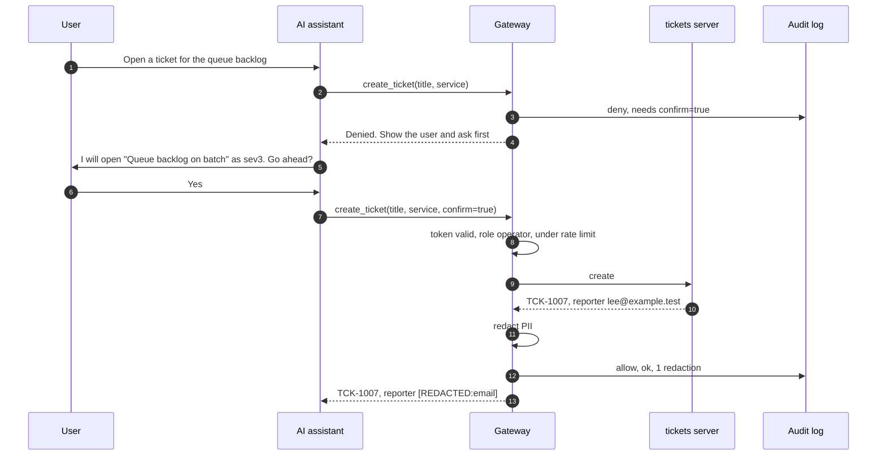

<div align="center">



# Governed MCP Gateway

Let AI assistants work with your operations tools without handing them the keys.

<a href="pyproject.toml"></a>
<a href="src/governed_mcp/gateway/core.py"></a>
<a href="src/governed_mcp/gateway/auth.py"></a>
<a href="src/governed_mcp/servers"></a>
<a href="tests"></a>
<a href="Dockerfile"></a>
<a href=".github/workflows/ci.yml"></a>
<a href="LICENSE"></a>

</div>

<br>

## In numbers

| | |
| --- | --- |
| 3 | MCP servers (cloud inventory, runbooks, tickets) sharing one governance layer |
| 8 | Tools, 7 read and 1 write. The write tool runs only with `confirm=true` |
| 7 | Stages every call passes, from authentication to audit |
| 3 | Role policies in YAML, deny by default |
| 10 | Secret and PII detectors on every result, plus sensitive field names |
| 10 | Forged or invalid JWT cases rejected in tests, including `alg: none` and HS256 key confusion |
| 16 | Security controls, each mapped to a threat, a file and a test |
| 88 | Tests, including end to end over stdio and Streamable HTTP with a real MCP client |
| 0 | Ways to register a tool that skips the gateway |

## What it is

A reference implementation of how to connect AI assistants to enterprise systems through the Model Context Protocol, with the controls a security review will ask for already in place. Three example servers expose realistic operations tools over synthetic data. Every tool call goes through the same gateway, which knows who is calling, what their role allows, whether the action changes anything, and what must never leave the boundary. The result is an assistant that is useful on day one and an audit trail that answers who asked it to do what.

## Architecture



The gateway is a library, not a proxy. Each server is a `GovernedServer`, a subclass of the SDK's `MCPServer`, and tools can only be added through `governed_tool(access="read" | "write")`. Plain `@tool()` raises, and a write tool without a `confirm: bool = False` parameter is refused at startup. The reasoning is in [ADR 0001](docs/adr/0001-enforce-governance-inside-each-server.md).

## One tool call



The denial message is written for the assistant, so it knows what to do next instead of retrying blindly. The reporter is stamped from the authenticated identity, never from the arguments.

## Roles

| Capability | reader | operator | admin |
| --- | :-: | :-: | :-: |
| List and read cloud resources | yes | yes | yes |
| Monthly cost by tag (showback) | no | yes | yes |
| Search and read runbooks | yes | yes | yes |
| Search and read tickets | yes | yes | yes |
| Open tickets (with `confirm=true`) | no | yes | yes |
| Rate limit, requests per minute (burst) | 30 (10) | 60 (20) | 120 (40) |

Tools a role cannot call are removed from `tools/list`, so they never enter the assistant's context. Over HTTP the role comes from the `roles` claim of the caller's token, and the highest priority known role wins.

## Quick start

```bash
git clone https://github.com/marlyngiselle/governed-mcp-gateway.git
cd governed-mcp-gateway
python3 -m venv .venv && . .venv/bin/activate
pip install -e ".[dev]"
pytest
```

Run the tickets server over Streamable HTTP with a local signing key, then call it as two different roles.

```bash
governed-mcp dev-keys --out .dev
export GOVERNED_MCP_ISSUER=https://idp.example.test GOVERNED_MCP_AUDIENCE=governed-mcp
export GOVERNED_MCP_JWKS_FILE=.dev/jwks.json GOVERNED_MCP_PORT=8003 GOVERNED_MCP_AUDIT_LOG=.dev/audit.jsonl
governed-mcp serve tickets --transport http &

export GOVERNED_MCP_TOKEN=$(governed-mcp dev-token --role operator)
python examples/call_tool.py http://127.0.0.1:8003/mcp search_tickets '{"status": "open", "limit": 2}'

export GOVERNED_MCP_TOKEN=$(governed-mcp dev-token --role reader)
python examples/call_tool.py http://127.0.0.1:8003/mcp create_ticket '{"title": "Smoke test", "description": "Created from the quick start.", "service": "platform", "confirm": true}'
```

The second call is refused with `Denied: role 'reader' does not allow 'tickets.create_ticket'`. All three servers run together with `docker compose up --build` on ports 8001 to 8003. Client JSON for stdio and HTTP is in [docs/client-configuration.md](docs/client-configuration.md).

## Policy as code

```yaml
# policies/reader.yaml
role: reader
description: Read-only access for assistants that answer operational questions.
priority: 10
allow_writes: false
tools:
  allow:
    - "cloud-inventory.*"
    - "runbooks.*"
    - "tickets.search_tickets"
    - "tickets.get_ticket"
  deny:
    - "cloud-inventory.cost_by_tag"
rate_limit:
  requests_per_minute: 30
  burst: 10
```

Four rules, nothing hidden. Deny by default, explicit deny wins, writes need `allow_writes`, unknown roles get nothing. Unknown fields in a policy file fail validation, so a typo cannot silently widen access.

## What the audit log records

One JSON line per call, allowed or denied. This is the line written when an operator's assistant tried to open a ticket without asking first.

```json
{"ts":"2026-10-26T14:41:08.590+00:00","event":"tool_call","request_id":"623586b5-857b-4484-b915-b70beddda200","server":"tickets","tool":"create_ticket","access":"write","principal":"lee@example.test","client_id":"local-mcp-client","role":"operator","auth":"oidc","args_hash":"5f236d71e5166adebacbb137a44f70587f5b8c002a6d9513880f9b181ef7413a","args_hash_alg":"sha256","decision":"deny","reason":"'tickets.create_ticket' changes state and needs confirm=true. Show the user what will be done and ask before retrying.","outcome":"denied","latency_ms":0.051,"redactions":0}
```

Arguments are stored as a hash of their canonical JSON, never in clear, so the audit trail does not become a second copy of the data. Set `GOVERNED_MCP_AUDIT_HASH_KEY` to switch to HMAC-SHA256.

## Threats and controls

| Threat | Main controls | Proven by |
| --- | --- | --- |
| Prompt injection leading to tool misuse | Role policies, hidden tools, write confirmation, severity ceiling | `test_prompt_injection_in_a_runbook_cannot_turn_into_a_write` |
| Confused deputy | Role from the caller's own token, no shared service credential | `test_role_comes_from_the_token` |
| Data exfiltration | Redaction before results leave the server, masked internal errors | `test_secrets_and_pii_are_redacted_from_results` |
| Abuse and enumeration | Per-client rate limit, applied before authorisation | `test_rate_limit_applies_per_client` |
| Token forgery | JWKS, issuer, audience, expiry, asymmetric algorithms only | `tests/test_auth.py` |

The full model, with 16 controls and what this design does not solve, is in [docs/security-model.md](docs/security-model.md).

## Before you build on it

> [!IMPORTANT]
> The three back ends are synthetic. Inventory, runbooks and tickets return fixed, fictional data so the project runs anywhere and tests are deterministic. Replacing one with a real API means implementing the same small adapter interface. The gateway does not change.

> [!WARNING]
> On stdio, the role is whatever `GOVERNED_MCP_ROLE` says, set by the person who configures the client. That is the right trust model for a local tool acting as its user. For anything shared or remote, use Streamable HTTP, where the role comes from a verified token.

> [!CAUTION]
> `confirm=true` proves the assistant asked, not that the human read the question. Keep write tools narrow, reversible and below the severity that pages people. Assistants here cannot open sev1.

> [!NOTE]
> Version 2 of the MCP Python SDK renamed `FastMCP` to `MCPServer`. This project targets `mcp>=2.3,<3`.

## Repository map

| Path | What it holds |
| --- | --- |
| [`src/governed_mcp/gateway/`](src/governed_mcp/gateway) | The governance layer. Pipeline, policies, identity, JWT verification, rate limiter, redaction, audit |
| [`src/governed_mcp/servers/`](src/governed_mcp/servers) | The three MCP servers and their tool schemas |
| [`src/governed_mcp/adapters/`](src/governed_mcp/adapters) | Synthetic back ends standing in for real APIs |
| [`src/governed_mcp/app.py`](src/governed_mcp/app.py) | Wiring for stdio and Streamable HTTP. HTTP refuses to start without OIDC |
| [`src/governed_mcp/devkeys.py`](src/governed_mcp/devkeys.py) | Local signing key and token minting for development |
| [`policies/`](policies) | Role policies: reader, operator, admin |
| [`runbooks/`](runbooks) | Five synthetic runbooks, one of them carrying a prompt injection on purpose |
| [`tests/`](tests) | 88 tests across policy, redaction, rate limits, JWT, audit, tools, stdio and HTTP |
| [`examples/call_tool.py`](examples/call_tool.py) | A minimal MCP client session over HTTP |
| [`Dockerfile`](Dockerfile), [`docker-compose.yml`](docker-compose.yml) | Non-root image from a hashed lock file, three services on ports 8001 to 8003 |
| [`.github/workflows/ci.yml`](.github/workflows/ci.yml) | Ruff, mypy strict, pytest on 3.11 to 3.13, hadolint and image build |

## Documentation

| Document | Read it for |
| --- | --- |
| [Architecture](docs/architecture.md) | Components, the call pipeline and the two transports |
| [Security model](docs/security-model.md) | Threats, 16 controls with their tests, and the known gaps |
| [Add a tool in three steps](docs/adding-a-tool.md) | Write the tool, allow it in policy, test it through a client session |
| [Client configuration](docs/client-configuration.md) | JSON for stdio and HTTP clients, and every environment variable |
| [ADR 0001](docs/adr/0001-enforce-governance-inside-each-server.md) | Why governance lives inside each server and not in a proxy |
| [ADR 0002](docs/adr/0002-deny-by-default-yaml-policies.md) | Why role policies are deny-by-default YAML |
| [ADR 0003](docs/adr/0003-stateless-http-as-oauth-resource-server.md) | Why HTTP is stateless and acts only as an OAuth resource server |

<br>

<div align="center">
<sub>MIT licensed. Designed and built by Giselle Da Costa.</sub>
</div>
