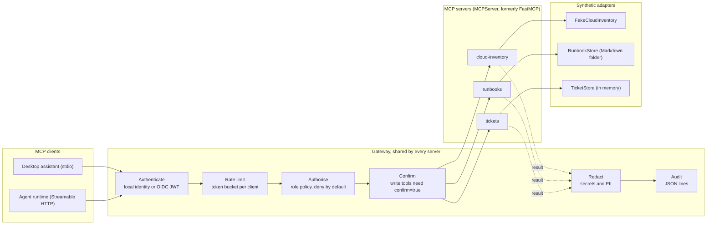
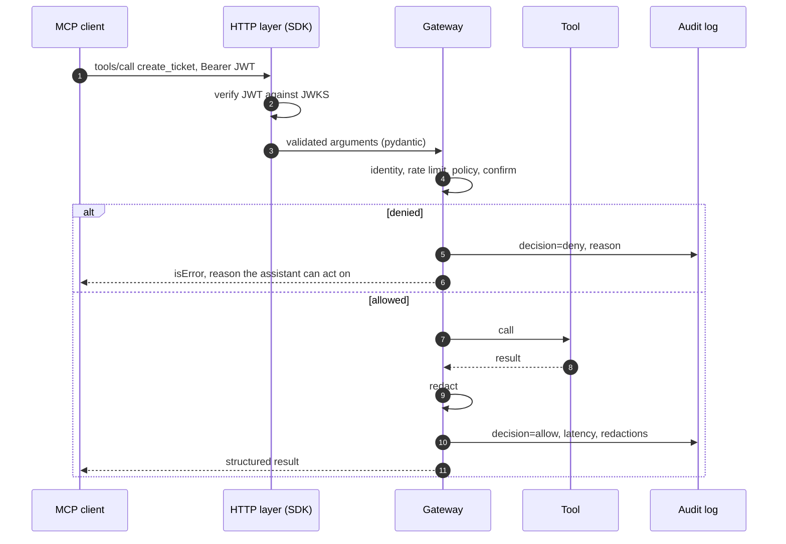

# Architecture

## The problem

An AI assistant connected to operations tools through MCP acts with whatever access those tools have. The assistant reads untrusted text all day (tickets, runbooks, web pages, user prompts), and any of it can try to steer the next tool call. Putting each control inside each tool does not scale and drifts. This project puts them in one place every tool must pass through.

## Components

| Component | File | Responsibility |
| --- | --- | --- |
| `GovernedServer` | `src/governed_mcp/gateway/core.py` | Subclass of the SDK's `MCPServer`. Only accepts tools through `governed_tool(access=...)` and filters `tools/list` by role |
| `Gateway` | `src/governed_mcp/gateway/core.py` | Runs the pipeline around every call and writes the audit record |
| `PolicySet` | `src/governed_mcp/gateway/policy.py` | Loads `policies/*.yaml`, decides allow or deny with a reason |
| `RateLimiter` | `src/governed_mcp/gateway/ratelimit.py` | Token bucket per `client_id` and principal, bounded memory |
| `Redactor` | `src/governed_mcp/gateway/redaction.py` | Ten value patterns plus sensitive field names, checksums for cards and IBANs |
| `AuditLog` | `src/governed_mcp/gateway/audit.py` | Append-only JSON lines with a schema enforced by pydantic |
| `JWTVerifier` | `src/governed_mcp/gateway/auth.py` | The SDK `TokenVerifier` for HTTP: JWKS, issuer, audience, expiry, algorithm allowlist |
| Identity resolvers | `src/governed_mcp/gateway/identity.py` | `LocalIdentity` for stdio, `BearerIdentity` for HTTP |
| Servers | `src/governed_mcp/servers/` | Tool definitions with pydantic constraints on every argument |
| Adapters | `src/governed_mcp/adapters/` | Synthetic back ends that stand in for real APIs |

## One call, step by step

## Transports

| | stdio | Streamable HTTP |
| --- | --- | --- |
| Who launches it | The MCP client, as a child process | A container or service |
| Identity | `GOVERNED_MCP_PRINCIPAL` and `GOVERNED_MCP_ROLE`, set by the person who configures the client | `sub` and `roles` claims of a verified OIDC access token |
| Authentication | The operating system user | OAuth 2.1 resource server, JWKS verification, RFC 9728 metadata |
| Session state | One process per client | Stateless, JSON responses, so it scales horizontally |
| Audit sink | A file (stdout is the protocol channel) | stderr, collected by the container runtime |

## What is synthetic

The three adapters return fixed, fictional data so the repository runs anywhere and tests are deterministic. Swapping one for a real system means implementing the same small interface (`query`, `get`, `search`, `create`) against a real API. The gateway, policies and tests do not change.
